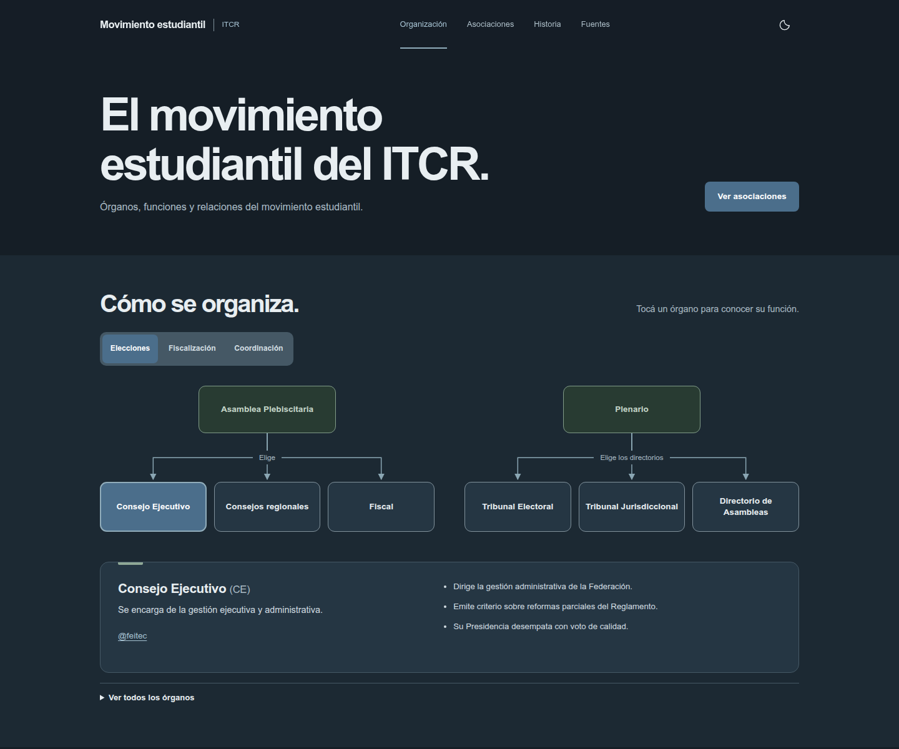

<div align="center">
  
  <h1>ME ITCR</h1>
  <p>Movimiento estudiantil del Instituto Tecnológico de Costa Rica.</p>
  <p>Organización · Asociaciones · Historia</p>
</div>



Una guía para conocer los órganos del movimiento estudiantil, encontrar su asociación de carrera y consultar la historia del movimiento. Proyecto estudiantil, no oficial.

HTML, CSS y JavaScript, sin dependencias de producción. Incluye temas claro y oscuro, un diagrama interactivo y búsqueda de asociaciones por nombre, carrera, escuela o sede.

## Abrir en su computadora

Use pnpm 12.16.1.

```sh
pnpm install
pnpm serve
```

Abra <http://localhost:4173>.

## Dónde editar

| Archivo | Contenido |
| --- | --- |
| [`data/asociaciones.json`](data/asociaciones.json) | Asociaciones, carreras, sedes y perfiles de Instagram. |
| [`data/contenido.json`](data/contenido.json) | Órganos, relaciones y perfiles de la Federación. |
| [`index.html`](index.html) | Estructura e historia. |
| [`assets/css/styles.css`](assets/css/styles.css) | Paleta, temas y diseño adaptable. |
| [`assets/js/`](assets/js/) | Diagrama, directorio y cambio de tema. |

En las asociaciones, escriba el usuario de Instagram sin `@` y deje los datos desconocidos como `""`.

## Pruebas

```sh
pnpm test
```

## Publicar en GitHub Pages

En el repositorio, seleccione **Settings → Pages → Build and deployment → Source → GitHub Actions**.

El [flujo de despliegue](.github/workflows/deploy-pages.yml) ejecuta las pruebas y publica el sitio con cada push a `main`. También puede ejecutarlo desde **Actions → Deploy to GitHub Pages → Run workflow**.

Solo se publican `index.html`, `assets/` y `data/`.

